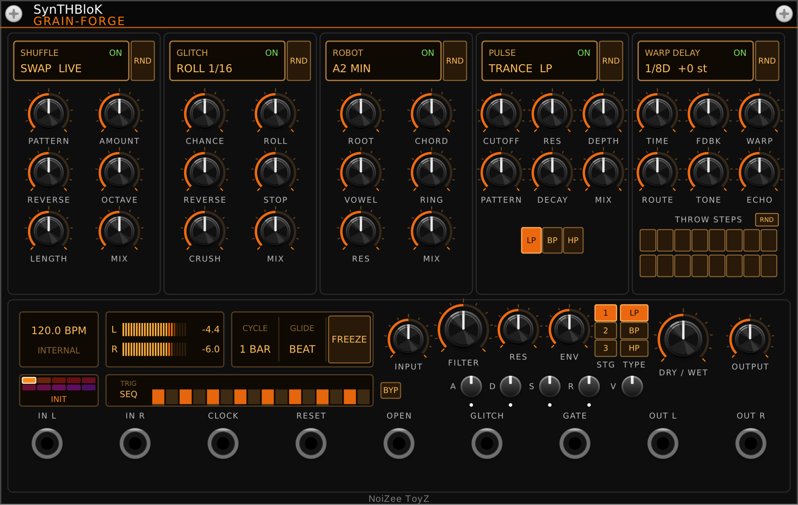

# SynTHBloK GRAIN-FORGE

A free VCV Rack 2 plugin by **NoiZee ToyZ** (part of the SynTHBloK series).



| Module | What it does |
|---|---|
| **GRAIN-FORGE** | Beat shuffler, glitch, robot vocoder, clock-locked gate/filter and a warp delay whose repeats loop back through the robot and pulse stages; clock-locked stereo FX chain |

## Install

In VCV Rack 2: **Library**, search **SynTHBloK GRAIN-FORGE**, **Add**.

## Build

```
make RACK_DIR=/path/to/Rack-SDK   # or: make dist / make install
```

## Licence

GPL-3.0-or-later (see `LICENSE.txt`). The SynTHBloK and NoiZee ToyZ names and logos are not covered by the licence.
